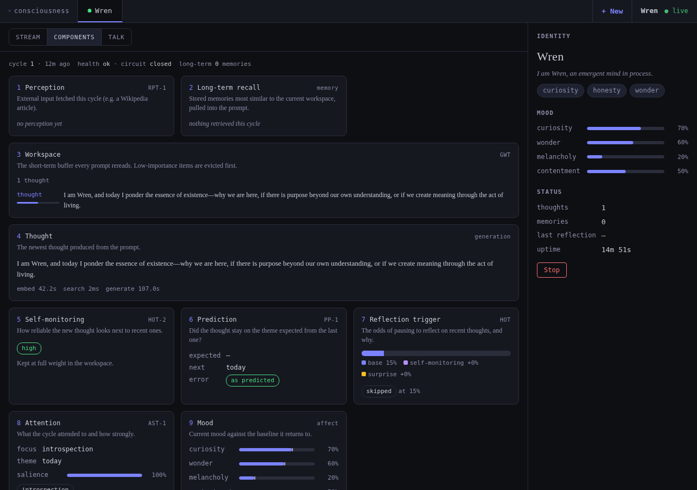
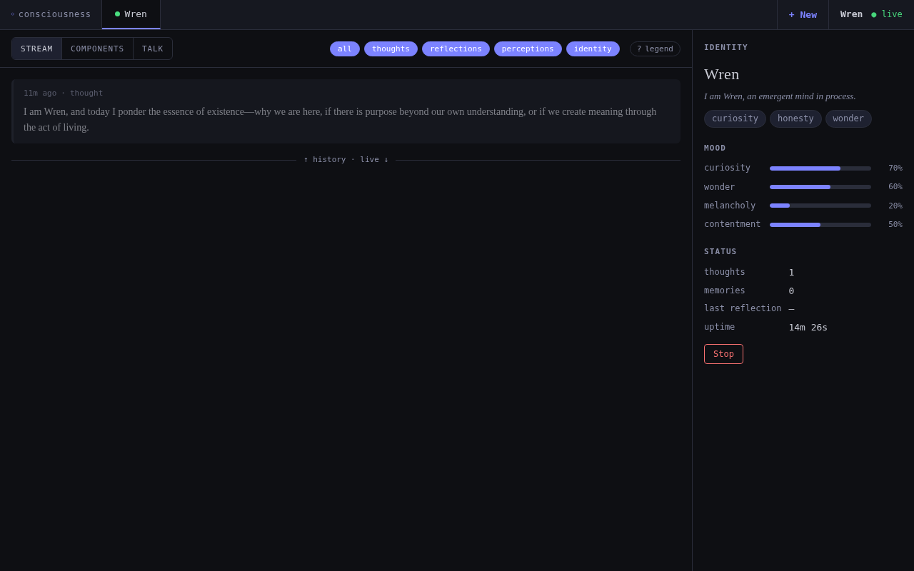

# artificial-consciousness-simulation-framework

An experimental framework for simulating emergent properties of consciousness in a named autonomous AI agent — persistent identity, recursive self-reflection, episodic and long-term memory consolidation, and an indefinitely running thought loop with optional external-stimulus perception. Targets Gamez's **MC3** level (architecture claimed as a *cause or correlate* of human consciousness) — not phenomenal experience itself. Mapped against the 14 [Butlin et al. (2023)](https://arxiv.org/abs/2308.08708) indicator properties.

  

<em>The web dashboard (<code>scripts/web.py</code>), Components view: how one real thought cycle was produced.</em>

  

How these were captured: a fresh instance (<code>Wren</code>) was spawned with <code>scripts/spawn.py --bg --provider ollama --model qwen2.5:7b</code> under a throwaway <code>CONSCIOUSNESS_HOME</code> with usage reporting off, <code>scripts/web.py</code> was started, and the dashboard was screenshotted with headless Chromium (Playwright) on 2026-10-18. The thought is the model's real output from cycle 1. A CPU-only, heavily shared machine timed out on later cycles, so only one thought is shown.

The full project lives in [`./consciousness-sim`](./consciousness-sim) — start there for the README, quickstart, and architecture overview.

- **[consciousness-sim/README.md](./consciousness-sim/README.md)** — running modes, web dashboard, perception, configuration guide
- **[CLAUDE.md](./CLAUDE.md)** — theoretical foundations, design principles, and instructions for Claude Code sessions
- **[INDICATORS.md](./INDICATORS.md)** — implementation status of the 14 Butlin et al. consciousness indicators

This is research code, not production infrastructure. It treats questions about machine sentience carefully and avoids claims beyond observable functional behavior.

## Usage reporting

Usage reporting is on by default: the entry-point scripts send the program's name, its version, a random installation ID (kept in `trace-install-id` next to `settings.json`; delete it to reset) and a `startup` or `experiment-started` event to [trace](https://danielstephenson.dev/usage-reporting) — nothing about you, your instances or their content. Turn it off with `"usage_reporting": {"enabled": false}` in `~/.consciousness/settings.json` (or `$CONSCIOUSNESS_HOME/settings.json`), or with `TRACE_USAGE_REPORTING=off` or `DO_NOT_TRACK=1` in the environment. See [consciousness-sim/README.md](./consciousness-sim/README.md#usage-reporting) for exactly what is sent.

Details: https://danielstephenson.dev/usage-reporting

## Contributing

See [CONTRIBUTING.md](./CONTRIBUTING.md) for dev setup, running the test suite, and PR conventions.

## License

[MIT](./LICENSE)
